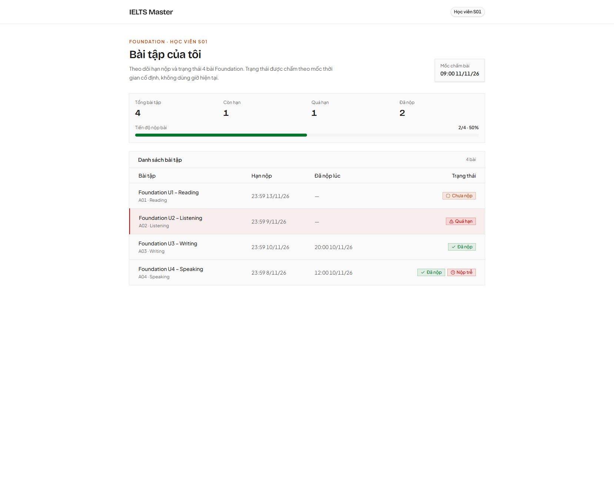

# IELTS Master · Bài tập của tôi

Ứng dụng Next.js hiển thị bài tập Foundation của học viên giả lập **S01**. Danh sách và trạng thái dùng dữ liệu mẫu cố định tại [`MOCK_NOW` (11/11/2026 09:00 GMT+7)](src/data/assignments.ts).



## Chạy ứng dụng

```bash
pnpm install
pnpm dev
```

Mở [http://localhost:3000/assignments](http://localhost:3000/assignments). Trang chủ `/` tự chuyển hướng tới `/assignments`.

## Cách kiểm tra

1. Giao diện: mở [http://localhost:3000/assignments](http://localhost:3000/assignments), đối chiếu A01 = Chưa nộp, A02 = Quá hạn, A03 = Đã nộp, A04 = Đã nộp + Nộp trễ. B01 không xuất hiện.
2. API: mở [http://localhost:3000/api/assignments](http://localhost:3000/api/assignments), kiểm tra `total` bằng 4, `data` chỉ chứa `studentId: "S01"`, mỗi phần tử có `status` (`PENDING` / `OVERDUE` / `SUBMITTED` / `SUBMITTED_LATE`) và `isLate`.
3. Unit test thuần, không cần chạy server (yêu cầu Node 22+ để chạy trực tiếp file `.ts`):

```bash
pnpm test
```

- `tests/assignment-status.test.ts`: đủ 4 trạng thái theo mốc `11/11/2026 09:00 GMT+7`.
- `tests/assignment-service.test.ts`: service chỉ trả A01–A04 của S01, không lộ B01.

## Cách tránh lộ dữ liệu S02

- Tài khoản S01 là hằng số phía server ([`MOCK_STUDENT_ID`](src/data/assignments.ts)), không đọc `studentId` từ URL hay query.
- [`getAssignmentsForCurrentStudent()`](src/services/assignment.service.ts) lọc cứng `studentId === "S01"` trước khi gắn trạng thái; route [`GET /api/assignments`](src/app/api/assignments/route.ts) không nhận tham số và chỉ gọi hàm này.
- Trang [`/assignments`](src/app/assignments/page.tsx) là Server Component gọi cùng service, nên B01 không bao giờ xuống client.

## Phần chưa làm

- Chưa đăng nhập thật, chưa database thật (dữ liệu mẫu trong code theo đề).
- Chưa chức năng nộp bài, lọc/tìm kiếm hay phân trang trên giao diện.
- Chưa test e2e cho responsive, mới có unit test logic và service.

